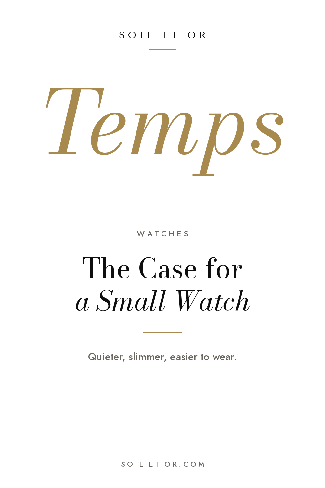
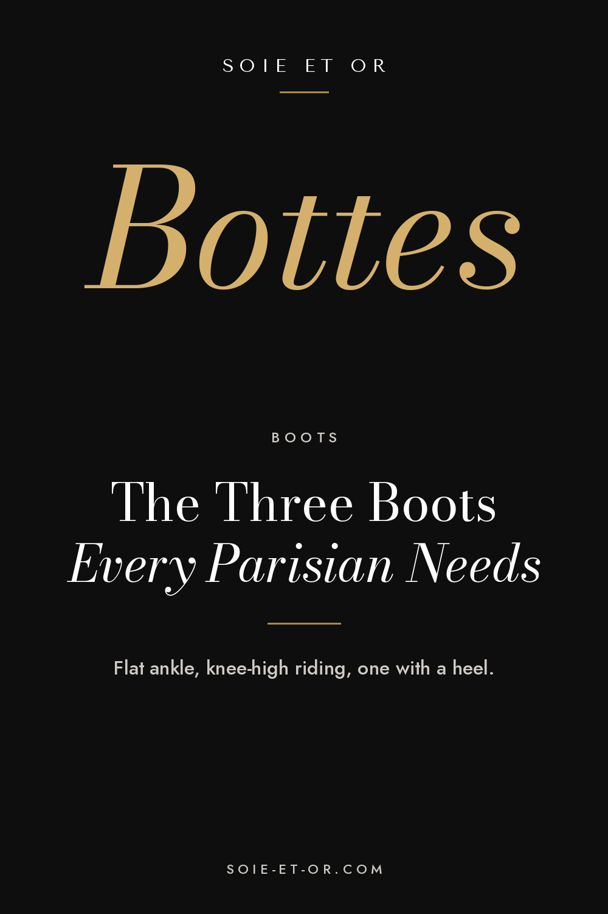
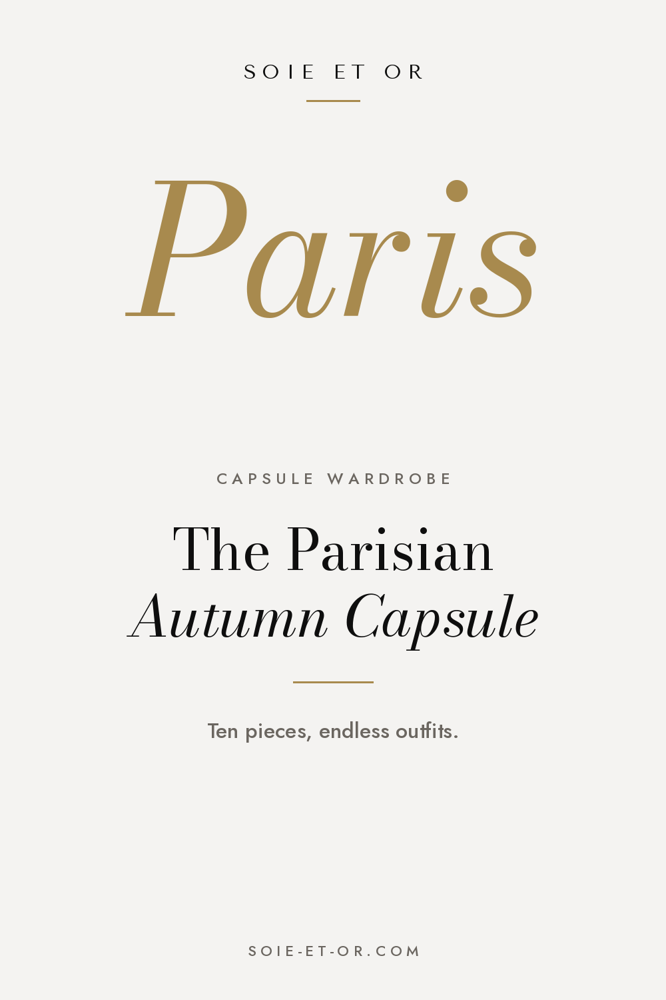
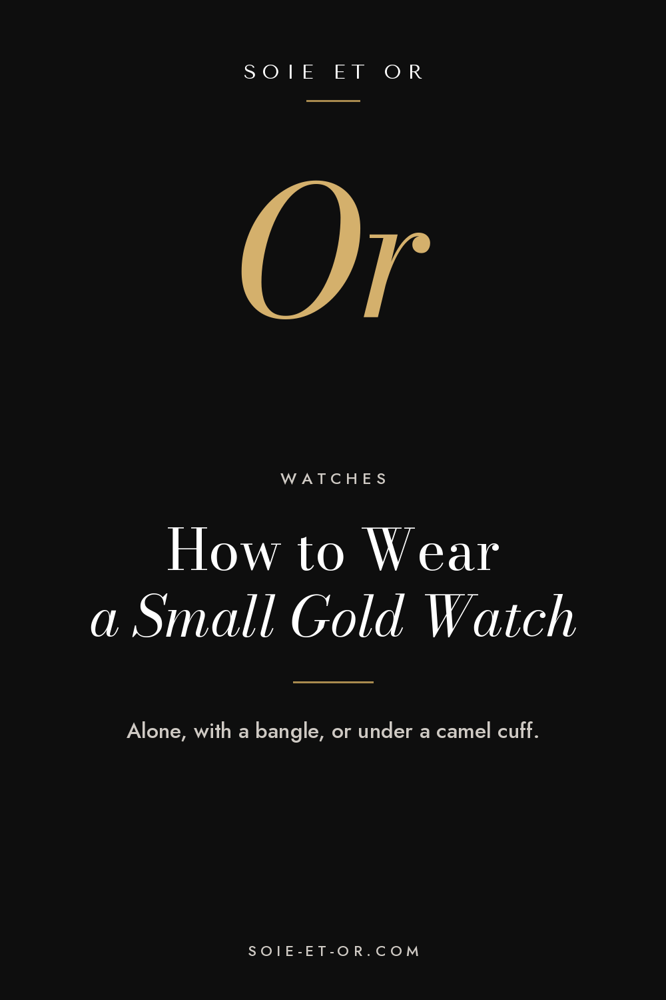
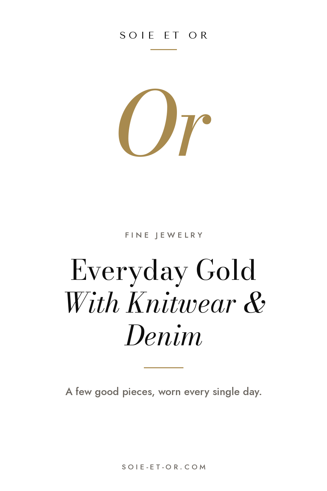
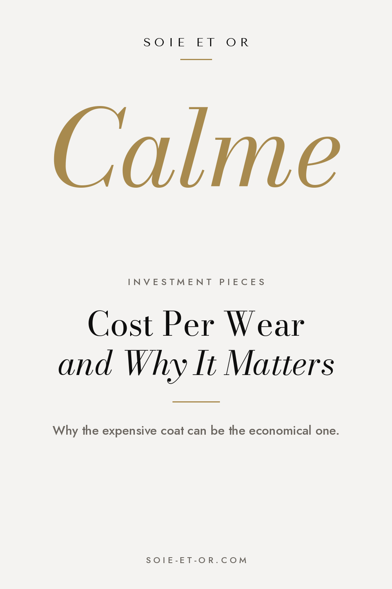
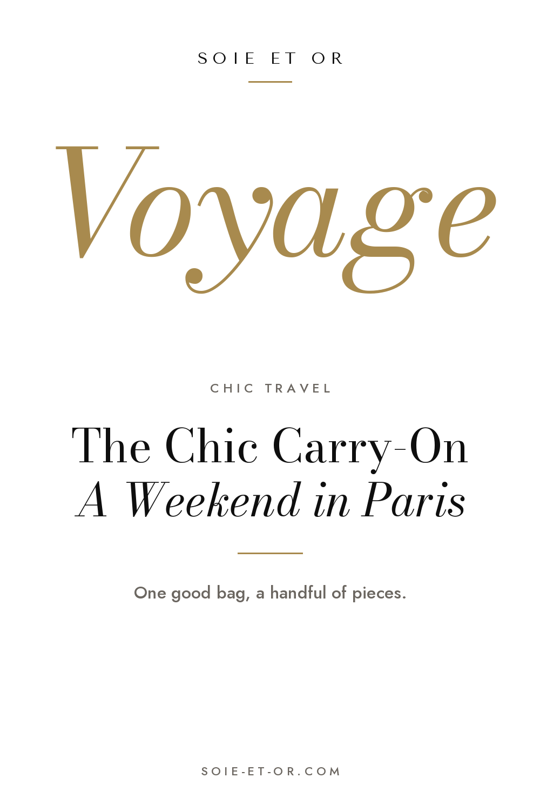

# Pinplanning

Upload each image in Pinterest, paste the fields and pick the board.

## 01-small-watch



- **When:** Fri 13 Nov, 20:00
- **Board:** Luxury Watches for Women
- **Title:** The Case for a Small Watch: Why Petite Watches Look So Right Now
- **Link:** https://www.soie-et-or.com/journal/the-case-for-a-small-watch.html
- **Tagged topics:** Women's watches · Small watches · Cartier Tank · Quiet luxury · Minimalist style · Parisian style

Description:

```
Small watches are back. How to choose the right case size and shape for your wrist, strap or bracelet, and how to wear a petite watch the Parisian way.
```

## 02-three-boots



- **When:** Sun 15 Nov, 20:00
- **Board:** Chic & Cool Boots Outfit
- **Title:** The Three Boots Every Parisian Wardrobe Needs
- **Link:** https://www.soie-et-or.com/journal/three-boots-parisian-wardrobe.html
- **Tagged topics:** Boots outfits · Knee high boots · Ankle boots · Winter outfits · Parisian style · French style

Description:

```
A flat ankle boot, a knee-high riding boot and one with a heel cover every autumn and winter day. Outfit ideas and how to make good boots last for years.
```

## 03-autumn-capsule



- **When:** Tue 17 Nov, 20:00
- **Board:** Parisian Capsule Wardrobe
- **Title:** The Parisian Autumn Capsule Wardrobe: Ten Pieces, Endless Outfits
- **Link:** https://www.soie-et-or.com/journal/parisian-autumn-capsule.html
- **Tagged topics:** Capsule wardrobe · French capsule wardrobe · Autumn outfits · Parisian style · Minimalist wardrobe · Quiet luxury

Description:

```
A small French capsule wardrobe for autumn and winter, built the way Parisian women actually dress. Ten pieces, three easy outfit formulas and what to leave out.
```

## 04-small-watch-gold



- **When:** Thu 19 Nov, 20:00
- **Board:** Quiet Luxury
- **Title:** How to Wear a Small Gold Watch Every Day
- **Link:** https://www.soie-et-or.com/journal/the-case-for-a-small-watch.html
- **Tagged topics:** Gold watch · Women's watches · Quiet luxury · Everyday jewelry · Elegant style · Watch and bracelet stack

Description:

```
Three easy ways to wear a petite watch with knitwear and coats, plus how to pick a strap or bracelet. Quiet luxury for every day.
```

## 05-everyday-gold



- **When:** Mon 23 Nov, 20:00
- **Board:** Everyday Gold Jewelry
- **Title:** Everyday Gold Jewelry: How to Wear Fine Jewelry With Knitwear and Denim
- **Link:** https://www.soie-et-or.com/journal/everyday-gold-jewelry.html
- **Tagged topics:** Gold jewelry · Fine jewelry · Layered necklaces · Ring stack · Everyday jewelry · Parisian style

Description:

```
How Parisian women wear fine gold jewelry every day: one signature piece, chains over a turtleneck, rings with jeans and easy rules for stacking.
```

## 06-cost-per-wear



- **When:** Sat 21 Nov, 20:00
- **Board:** Investment Pieces
- **Title:** Cost Per Wear: How to Think About Investment Pieces
- **Link:** https://www.soie-et-or.com/journal/cost-per-wear.html
- **Tagged topics:** Investment pieces · Cost per wear · Slow fashion · Capsule wardrobe · Quiet luxury · Timeless style

Description:

```
A simple calculation that changes how you shop. How to judge investment pieces like a good coat or boots, and buy fewer, better things.
```

## 07-paris-weekend



- **When:** Wed 25 Nov, 20:00
- **Board:** Chic Travel style
- **Title:** The Chic Carry-On: What to Pack for a Weekend in Paris
- **Link:** https://www.soie-et-or.com/journal/chic-travel-packing.html
- **Tagged topics:** Paris packing list · Carry on packing · Travel outfits · Weekend in Paris · Chic travel · Paris outfits

Description:

```
A Paris weekend packing list that fits in one carry-on: a few pieces that all work together and the accessories that make travel look effortless.
```
