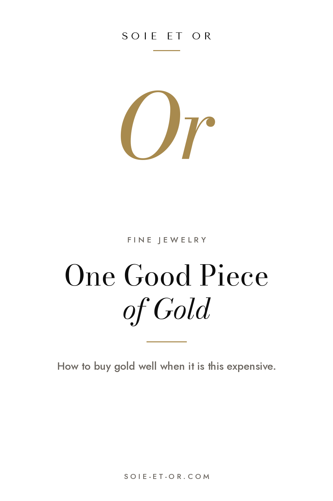
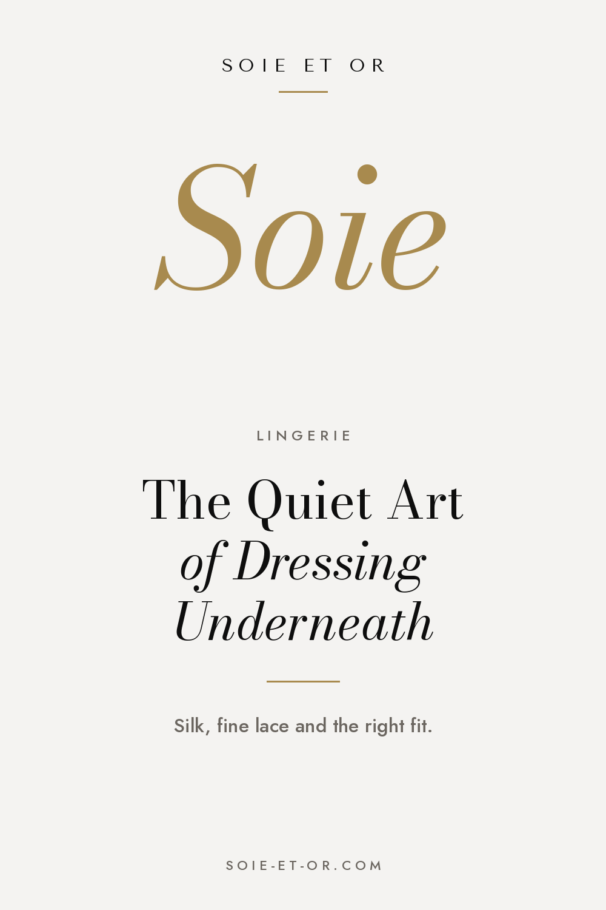
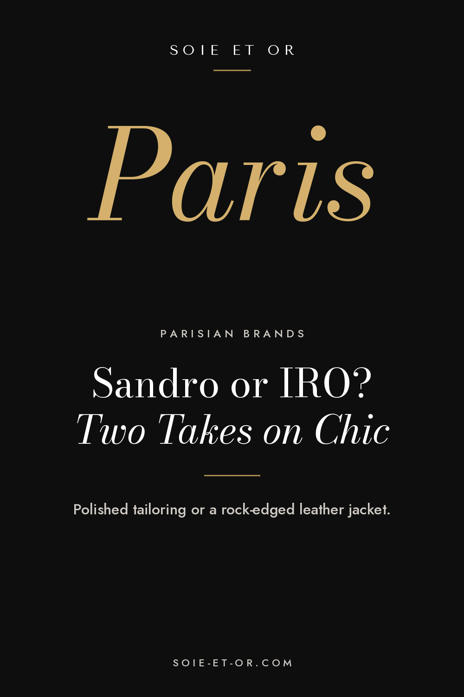
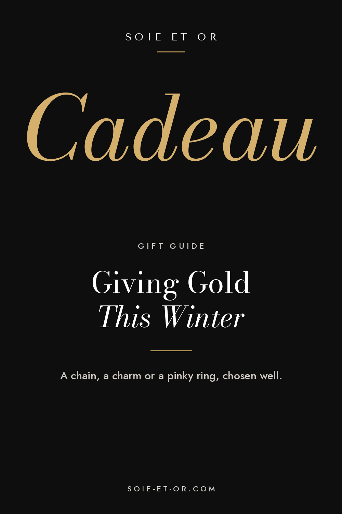
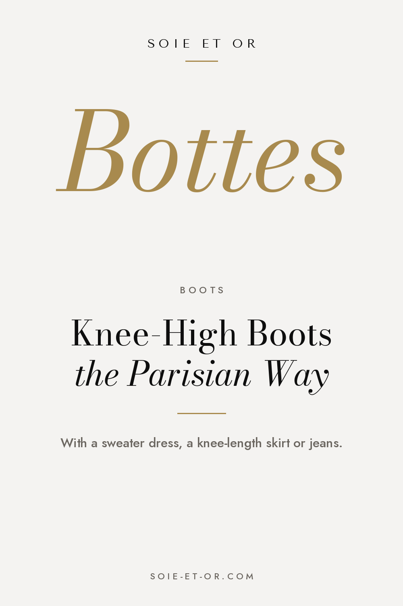
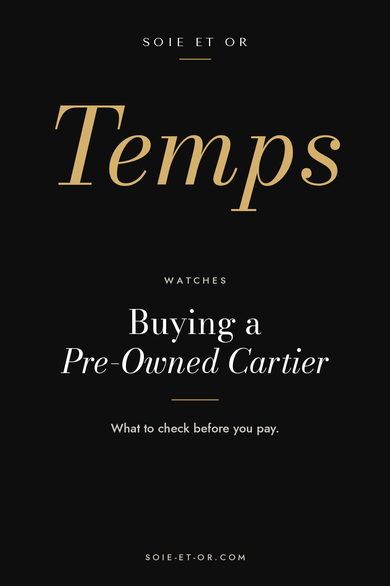

# Pinplanning

Upload each image in Pinterest, paste the fields and pick the board.

## 01-one-good-piece



- **When:** Tue 10 Nov, 20:00
- **Board:** Everyday Gold Jewelry
- **Title:** How to Buy Fine Gold Jewelry When Gold Is Expensive
- **Link:** https://www.soie-et-or.com/journal/buying-gold-jewelry-high-prices.html
- **Tagged topics:** Gold jewelry · Fine jewelry · 18k gold · Investment pieces · Minimalist jewelry · Quiet luxury

Description:

```
Gold prices are high, so buy less and choose better. What 18k and 9k really mean, how to read French hallmarks and the five gold pieces worth one good purchase.
```

## 02-french-lingerie



- **When:** Wed 11 Nov, 20:00
- **Board:** Elegant French Lingerie
- **Title:** French Lingerie: Silk, Fine Lace and the Right Fit
- **Link:** https://www.soie-et-or.com/journal/french-lingerie-guide.html
- **Tagged topics:** French lingerie · Silk lingerie · Lace lingerie · Silk camisole · French style · Parisian style

Description:

```
Why French women treat lingerie as the first layer of a good outfit. How to get the fit right, which fabrics are worth paying for and how to wear a silk camisole under a blazer.
```

## 03-sandro-or-iro



- **When:** Thu 12 Nov, 20:00
- **Board:** Parisian Style Outfits
- **Title:** Sandro or IRO? Two Takes on Parisian Chic
- **Link:** https://www.soie-et-or.com/journal/two-takes-on-parisian-chic.html
- **Tagged topics:** Parisian style · French brands · Sandro · IRO Paris · Leather jacket outfits · French girl style

Description:

```
Two Paris labels, two moods: Sandro's polished tailoring and IRO's rock-edged leather jackets. How to tell which French brand suits your wardrobe, and what to know about fit and sizing.
```

## 04-gold-gift



- **When:** Fri 13 Nov, 20:00
- **Board:** Investment Pieces
- **Title:** Fine Gold Jewelry Gift Ideas: A Chain, a Charm or a Pinky Ring
- **Link:** https://www.soie-et-or.com/journal/buying-gold-jewelry-high-prices.html
- **Tagged topics:** Jewelry gift ideas · Gold necklace · Charm necklace · Pinky ring · Fine jewelry · Christmas gift ideas

Description:

```
Thinking of gold jewelry as a gift this winter? Simple advice on choosing a chain, a meaningful charm, a pinky ring or small hoops, and what to check before you pay.
```

## 05-quiet-luxury


- **When:** Sat 14 Nov, 20:00
- **Board:** Quiet Luxury
- **Title:** What Quiet Luxury Really Means (and What It Does Not)
- **Link:** https://www.soie-et-or.com/journal/what-is-quiet-luxury.html
- **Tagged topics:** Quiet luxury · Old money style · Minimalist style · Timeless style · Classic outfits · Elegant style

Description:

```
Quiet luxury is not a beige uniform or a price tag. What the look is really about, from fabric and fit to fewer logos, and where to start building a quieter wardrobe.
```

## 06-knee-high-boots



- **When:** Sun 15 Nov, 20:00
- **Board:** Chic & Cool Boots Outfit
- **Title:** How Parisians Wear Flat Knee-High Boots in Winter
- **Link:** https://www.soie-et-or.com/journal/three-boots-parisian-wardrobe.html
- **Tagged topics:** Knee high boots outfit · Riding boots · Winter outfits · Sweater dress outfit · Parisian style · French style

Description:

```
Flat knee-high riding boots with a sweater dress, a knee-length skirt or tucked-in jeans. The three boots a Parisian winter wardrobe needs and how to make them last.
```

## 07-pre-owned-cartier



- **When:** Mon 16 Nov, 20:00
- **Board:** Luxury Watches for Women
- **Title:** Buying a Pre-Owned Cartier Watch: What to Check Before You Pay
- **Link:** https://www.soie-et-or.com/journal/pre-owned-cartier-watch-guide.html
- **Tagged topics:** Cartier watch · Pre-owned watches · Women's watches · Luxury watches · Investment pieces · Quiet luxury

Description:

```
A calm checklist for buying a pre-owned Cartier watch: papers, service history, condition and where to buy, so a classic like the Tank becomes a watch for life.
```
