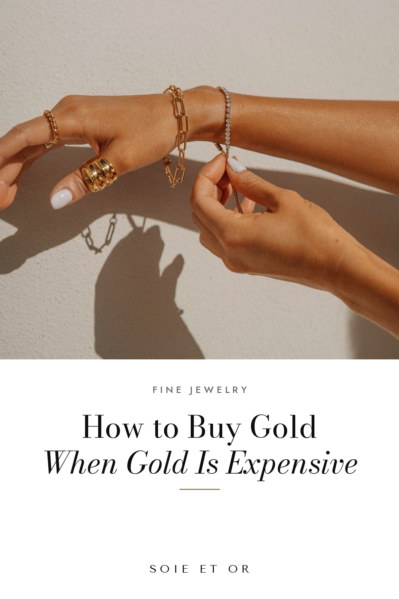

# Pinplanning

Upload each image in Pinterest, paste the fields and pick the board.

## 01-photo-gold



- **When:** Fri 20 Nov, 20:00
- **Board:** Everyday Gold Jewelry
- **Title:** How to Buy Gold Jewelry When Gold Prices Are High
- **Link:** https://www.soie-et-or.com/journal/buying-gold-jewelry-high-prices.html
- **Tagged topics:** Gold jewelry · Fine jewelry · Investment pieces · Minimalist jewelry · Quiet luxury

Description:

```
Gold has rarely cost more, so buy one good piece instead of three. What 18k and 9k mean, how to read French hallmarks and which gold pieces are worth it.
```

## 02-photo-small-watch


- **When:** Sun 22 Nov, 20:00
- **Board:** Luxury Watches for Women
- **Title:** Small Watches for Women: Why Petite Is Back
- **Link:** https://www.soie-et-or.com/journal/the-case-for-a-small-watch.html
- **Tagged topics:** Women's watches · Luxury watches · Vintage watches · Parisian style · Quiet luxury

Description:

```
A small, slim watch is quieter and easier to wear every day. How to choose the case size and bracelet that suit your wrist, the Parisian way.
```
